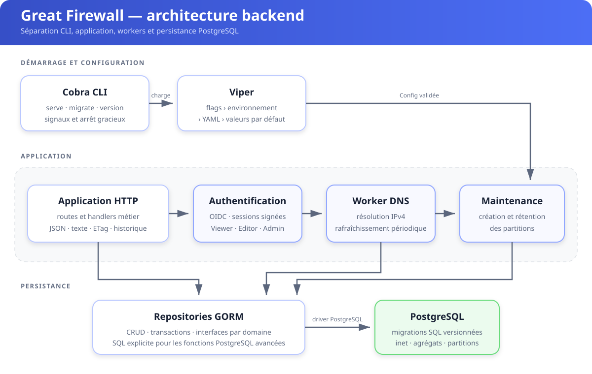
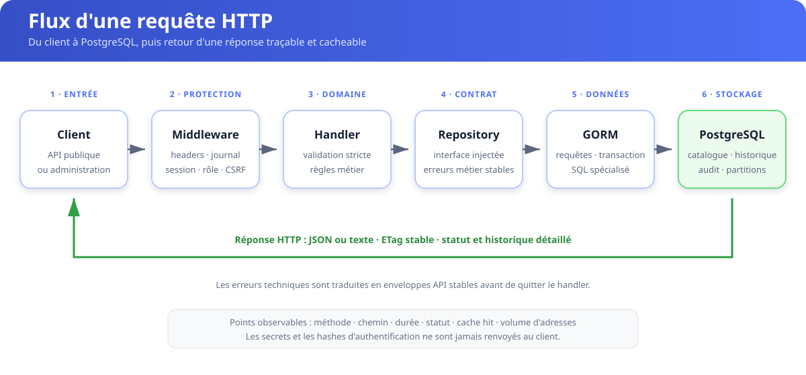

# Architecture du backend

Great Firewall est un service Go en couches. Cobra porte l'interface exécutable, Viper produit une configuration validée, l'application HTTP dépend d'interfaces de repository étroites et GORM implémente ces contrats sur PostgreSQL. Les migrations SQL versionnées restent la source de vérité du schéma.

## Responsabilités

- `internal/command` possède `serve`, `migrate`, `version`, les signaux et l'arrêt gracieux.
- `internal/config` fusionne valeurs par défaut, YAML, environnement et flags avant validation.
- `internal/app` possède les routes HTTP, les frontières d'autorisation, l'encodage et l'historique.
- `internal/auth` possède OIDC, les sessions signées et les rôles Viewer/Editor/Admin.
- `internal/dns` résout les noms de confiance derrière une interface injectable.
- `internal/store` possède les repositories GORM, les agrégats PostgreSQL et les partitions.
- `internal/migration` possède l'unique historique Goose SQL embarqué et son verrou PostgreSQL.

Les handlers métier dépendent de `app.Repository`, jamais directement de GORM. Le worker DNS utilise un contrat encore plus petit. Cette inversion rend les tests déterministes et évite une dépendance à Docker.

## Règles de dépendance

| Depuis | Peut dépendre de | Ne doit pas dépendre de |
| --- | --- | --- |
| `command` | `config`, `app`, `store` | handlers concrets ou modèles frontend |
| `app` | contrats repository, `auth`, `dns` | `gorm.DB` ou driver SQL |
| `dns` | son interface repository | HTTP et configuration globale |
| `store` | GORM et PostgreSQL | routage HTTP et authentification |

Une nouvelle fonctionnalité commence donc par un comportement métier et un contrat étroit. L'adaptateur GORM vient ensuite, puis le câblage dans la commande.

## Flux d'une requête

Le contrat OpenAPI et les payloads frontend restent stables. Les mutations sont protégées par rôle, les mutations authentifiées par cookie imposent la même origine et l'ingestion utilise des clés Bearer révocables stockées sous forme de hash.

## Processus en arrière-plan

- Le worker DNS démarre immédiatement, puis suit `dns_interval`; chaque résolution possède son propre `dns_timeout`.
- La maintenance crée les partitions futures et supprime celles dépassant `retention_days`.
- Les deux workers partagent le contexte du serveur. `Close` annule ce contexte et attend leur terminaison avant de rendre la main.

## Frontières de données

PostgreSQL conserve les écosystèmes, machines, services de confiance, clés d'ingestion, audits et historiques. GORM est privilégié pour le CRUD et les transactions. Le SQL explicite reste réservé aux constructions PostgreSQL dont la traduction ORM serait moins sûre ou moins lisible : `inet`, unions, percentiles et partitions.
