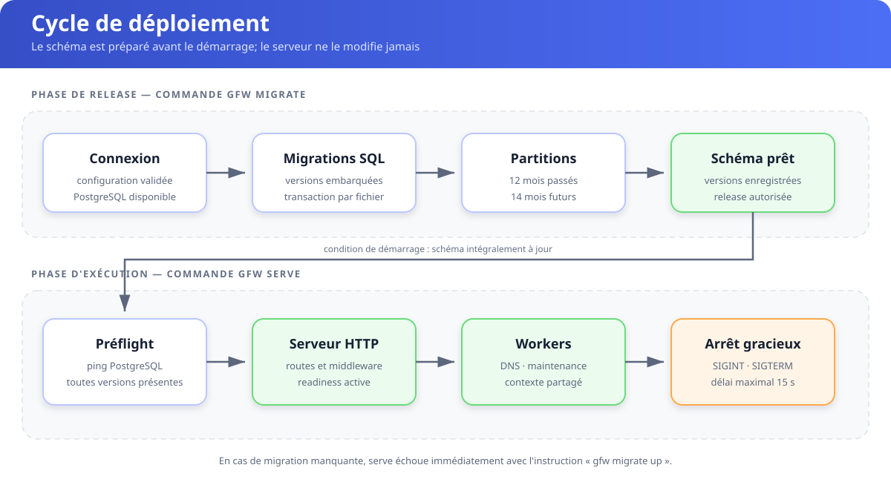

# Migrations and operations

Run `gfw migrate up` before deploying `gfw serve`. Goose applies the embedded,
forward-only SQL migrations transactionally, records their numeric versions and
uses a PostgreSQL session lock to serialize concurrent runs. It then prepares
monthly history partitions. `gfw migrate status` and `gfw migrate version` are
read-only inspection commands.

The server only checks connectivity and the exact applied history; it never
creates Goose metadata or applies DDL. In Kubernetes, the chart runs
`gfw migrate up` as a release Job. In Compose, the dedicated migration service
must complete before the application starts.

Readiness checks PostgreSQL; liveness only checks the process. Graceful shutdown stops HTTP admission, waits up to fifteen seconds for requests, and cancels DNS and maintenance workers.

The daily maintenance loop creates upcoming partitions and drops partitions older than `retention_days`. Migration SQL, not GORM `AutoMigrate`, is the schema source of truth.

Version 0.1.0 is the first supported schema. A database containing the legacy
`schema_migrations` table is rejected with an instruction to recreate it. For
Compose development, run `docker compose down --volumes` before upgrading from
an unreleased build. There is no rollback, force or baseline command; corrections
are delivered as new forward migrations.
